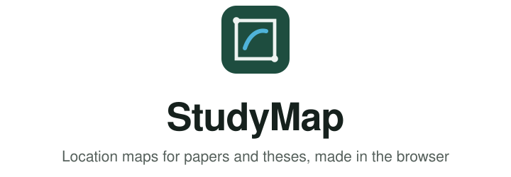
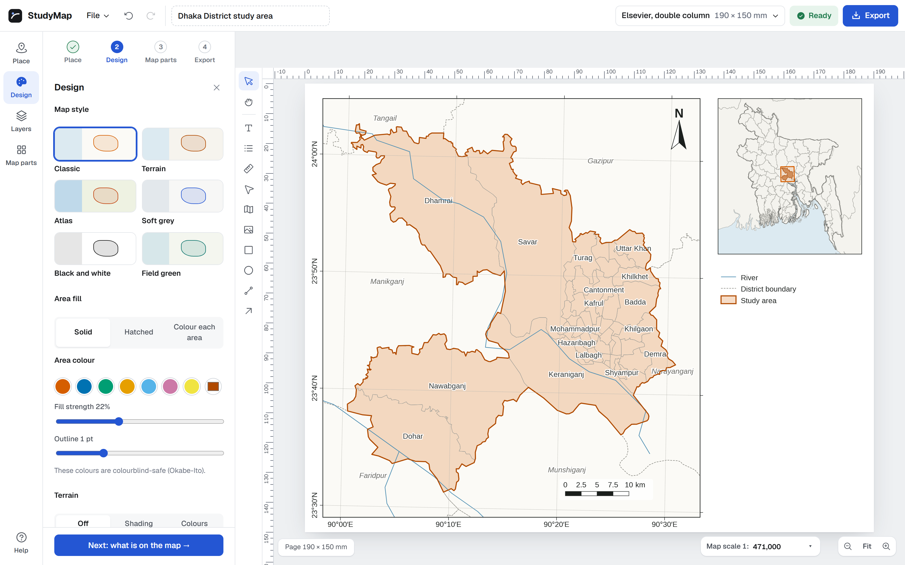
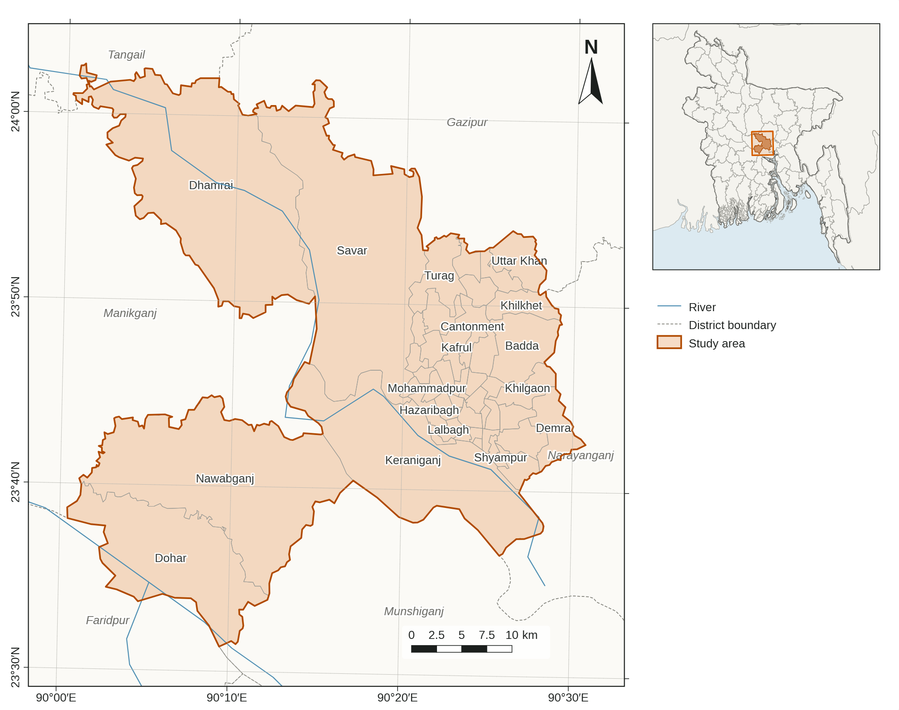
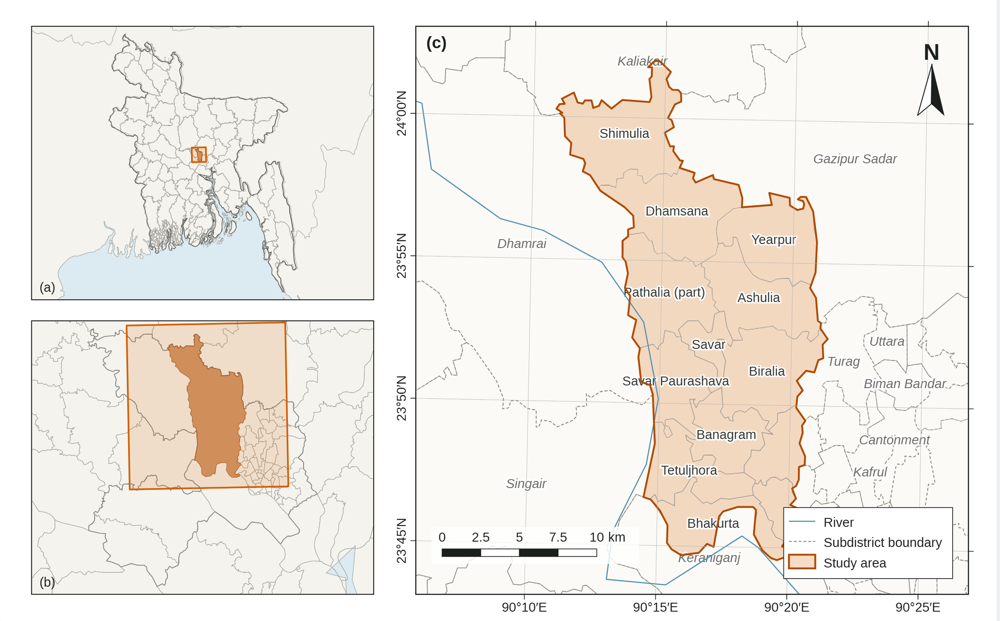
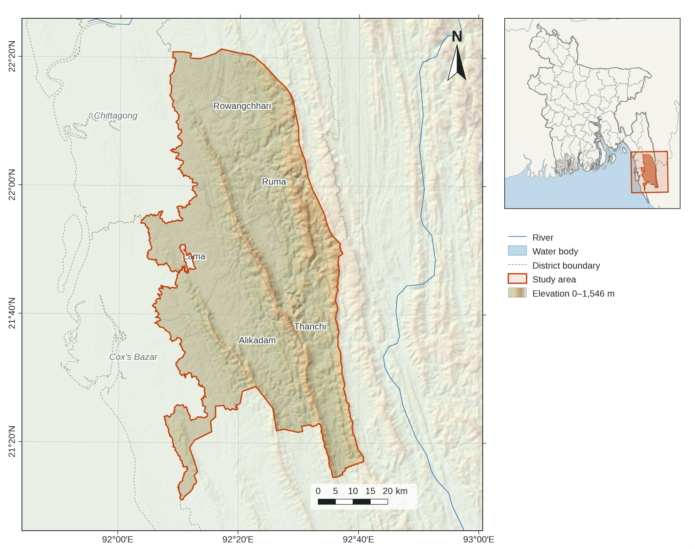

<p align="center">
  <picture>
    <source media="(prefers-color-scheme: dark)" srcset="docs/banner-dark.svg">
    
  </picture>
</p>

<p align="center">
  <picture>
    <source media="(prefers-color-scheme: dark)" srcset="https://skillicons.dev/icons?i=svelte%2Cts%2Cvite%2Cd3%2Cnodejs%2Chtml%2Ccss&theme=dark">
    
  </picture>
</p>

<h3 align="center"><a href="https://studymap.pages.dev">Open StudyMap → studymap.pages.dev</a></h3>



StudyMap makes the location map for a paper or thesis. Type a place name, pick your journal, and you get a finished
figure with the study area, an inset, coordinates, a scale bar and a north arrow. Export it as PDF, SVG, TIFF or PNG.

It's free and runs in your browser. No sign-up, nothing to install.

## Examples

| Locator inset | Drill-down (a)(b)(c) | Terrain |
|---|---|---|
|  |  |  |

## Never used GIS?

You don't need to. Search for your district or village, add your sampling sites from an Excel sheet, and choose
your journal from the list. StudyMap sets the size, fonts and layout, checks the figure against the journal's rules,
and writes the caption and data credits for you.

## Already use QGIS or ArcGIS?

StudyMap is quicker for this one figure, and it doesn't cut corners:

- Any CRS: automatic UTM or equal-area, national grids, or an EPSG code
- Opens shapefiles, GeoJSON, TopoJSON, KML, GPX, CSV and Excel
- Scale bar measured on the ellipsoid, north arrow to true north
- Graticule in DMS, DM, decimal degrees or metres
- Vector PDF with embedded fonts, SVG, and TIFF or PNG at 300 to 1200 dpi
- Boundaries from geoBoundaries, terrain from Copernicus GLO-30, OpenStreetMap layers, all licensed for publication

## Privacy

Your files stay in your browser. There's no server, no sign-up and no tracking. Map data comes straight from the
public sources listed in [DATA-SOURCES.md](DATA-SOURCES.md).

## Run it on your own computer

You can also run StudyMap on your computer, without the website.

1. Install [Node.js](https://nodejs.org) (the LTS version).
2. Download this project: green **Code** button → **Download ZIP**, then unzip it.
3. On Windows, double-click `run.bat`, and StudyMap opens in your browser.
   On Mac or Linux, open a terminal in the folder, run `npm install` and then `npm run dev`,
   and open http://localhost:5173.

The first start takes a minute while it sets itself up. To stop it, close the window. Place search and map data
still need the internet.

## For developers

```bash
npm install
npm run dev     # http://localhost:5173
npm test        # tests (test.bat on Windows)
npm run build   # static site in dist/
```

When hosting, set the environment variable `SITE_URL` to the site's address (for example
`https://studymap.pages.dev`) so link previews on social media show the picture. Cloudflare Pages works without it.

More in [tests/README.md](tests/README.md).

## Licence

[MIT](LICENSE). Map data keeps its own licence, see [DATA-SOURCES.md](DATA-SOURCES.md).
